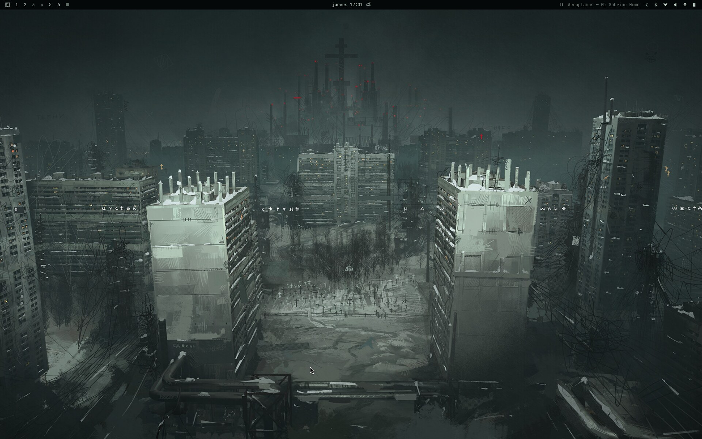
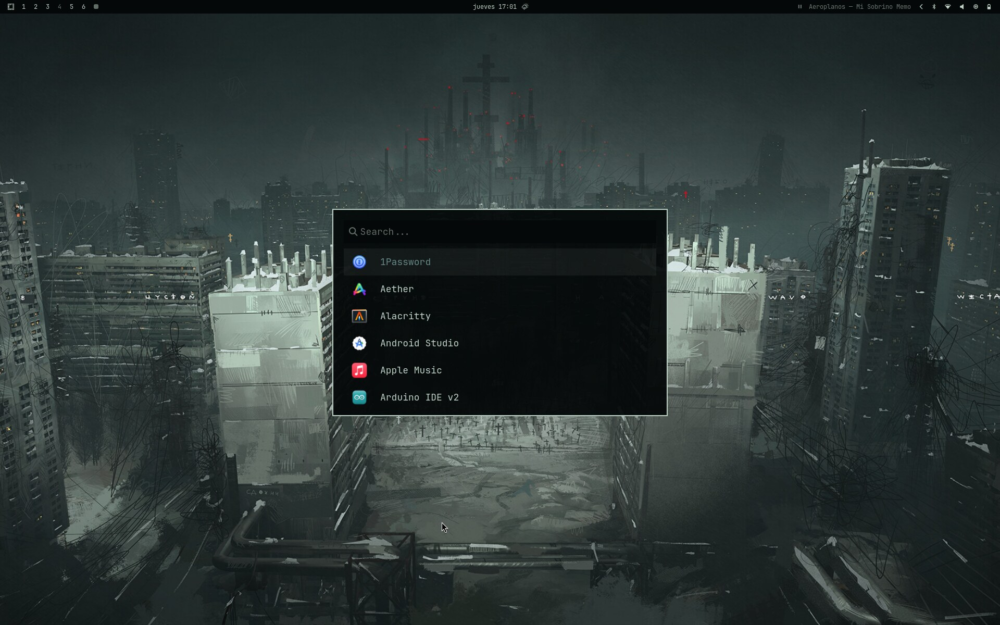
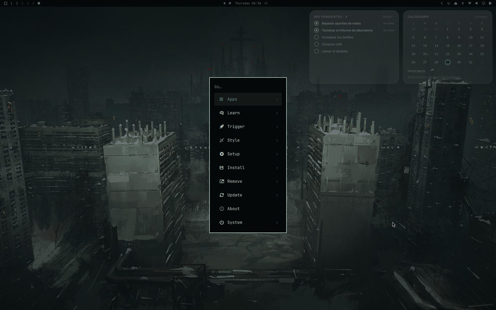
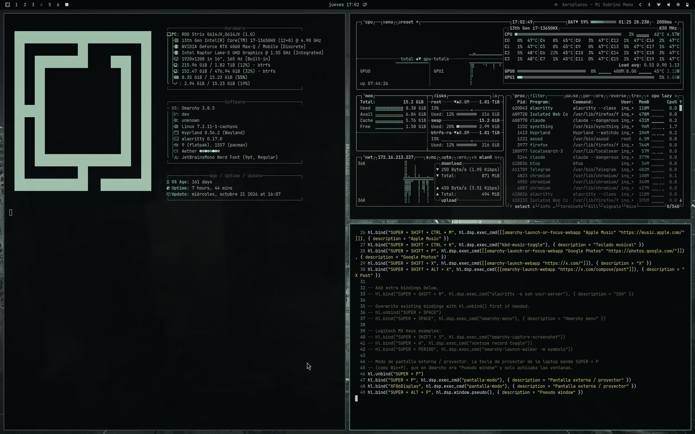
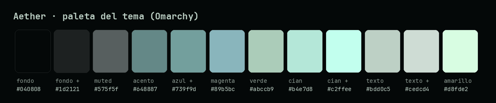

# dotfiles

[](https://github.com/Whiteherobot/dotfiles/actions/workflows/ci.yml)

Configuración de mi laptop **ASUS ROG Strix G16 (G614JV)**, con Intel Core i7-13650HX y NVIDIA RTX 4060 (gráficos híbridos), sobre CachyOS con [Omarchy](https://omarchy.org) (Hyprland).

**Está hecha para esa laptop.** En otra máquina sirve como referencia, pero lo de NVIDIA, el teclado RGB, la tecla de proyectar y el monitor interno dependen de este modelo.

Esta laptop recibió muchas críticas desde que salió. Al pasarla a Linux, casi todos los problemas resultaron ser de configuración y no del equipo. Este repo junta esos arreglos para no tener que descubrirlos otra vez: se clona, se corre el instalador y queda igual.

## Cómo se ve



| Lanzador de apps (`SUPER + SPACE`) | Menú de Omarchy (`SUPER + ALT + SPACE`) |
| --- | --- |
|  |  |






- **Tema:** Aether, una paleta propia en salvia y verde azulado. Es la misma que usan Pliego y Forjia. El fondo es [wallhaven-xekydd](https://wallhaven.cc/w/xekydd); el instalador lo descarga desde su fuente original, no va en el repo. Neovim usa `aether.nvim` con la misma paleta (`neovim.lua` del tema). Los temas sin `neovim.lua` propio lo reciben de `config/omarchy/themed/neovim.lua.tpl`, que Omarchy rellena con los colores del tema al aplicarlo; sin eso LazyVim falla con `Failed to load plugins.theme`.
- **Waybar:** a la derecha muestra barras de música (cava) y "ahora suena" (playerctl) cuando hay algo sonando, y se ocultan en silencio. Funciona con Apple Music, Spotify, YouTube y cualquier otro audio.
- **Teclado:** toma el color del tema. Con música, pulsa con los graves.

## Qué resuelve

| Problema en esta laptop | Arreglo | Archivo |
|---|---|---|
| Video con tirones y lag en multimedia: el panel cuelga de la Intel y todo se copiaba desde la NVIDIA | La decodificación de video pasa a la Intel (`LIBVA_DRIVER_NAME=iHD`) y el compositor sigue en NVIDIA. Mover la GPU primaria a la Intel rompe el login en este equipo | `config/uwsm/env` |
| Se colgaba al reanudar desde hibernación y había que forzar el apagado | El driver de NVIDIA ya no entra en el initramfs | `sistema/etc/mkinitcpio.conf.d/99-sin-nvidia-temprano.conf` |
| La hibernación perdía la sesión (`failed to quiesce async: error -5`) | La VRAM se guarda en `/var/tmp` y se habilitan `nvidia-suspend`, `nvidia-hibernate` y `nvidia-resume` | `sistema/etc/modprobe.d/nvidia-sleep.conf`, `sistema/instalar-sistema.sh` |
| La tecla de proyectar (Super+P) solo achicaba ventanas | Menú para duplicar, extender o usar solo la pantalla externa, como Win+P | `bin/pantalla-modo`, `config/hypr/bindings.lua` |
| El monitor interno quedaba apagado al desconectar el externo | Se recupera solo al iniciar la sesión | `config/systemd/user/omarchy-recover-internal-monitor.service` |
| Pedía dos contraseñas al arrancar | Autologin de SDDM más hyprlock al iniciar: se escribe una sola vez. El tema del login vive en ese mismo archivo, así que no hay que borrarlo | `sistema/etc/sddm.conf.d/autologin.conf`, `config/hypr/autostart.lua` |
| Docker sin acceso a la GPU y con logs que crecían sin límite | Runtime de NVIDIA y logs rotados (5 × 10 MB) | `sistema/etc/docker/daemon.json` |
| El teclado RGB (una sola zona) no seguía el tema | Color del tema y modo reactivo a la música, con pocos cambios para no gastar el disco (asusd reescribe su configuración en cada cambio) | `bin/kbd-music`, `config/cava/keyboard.conf` |

## Qué incluye

```
config/hypr/          Hyprland en Lua (atajos, monitores, apariencia, entrada) y hypridle/hyprlock/hyprsunset
config/uwsm/env       variables de la sesión (GPU híbrida)
config/waybar/        barra con música, indicadores y sus scripts
config/cava/          barras de la Waybar y graves para el teclado
config/omarchy/       tema Aether
config/systemd/user/  teclado reactivo y recuperación del monitor interno
bin/                  kbd-music, kbd-music-toggle, pantalla-modo
sistema/etc/          arreglos de sistema (se copian aparte, con sudo)
```

## Instalar

Requiere Omarchy instalado sobre CachyOS (o Arch).

```bash
git clone https://github.com/Whiteherobot/dotfiles.git ~/dotfiles
cd ~/dotfiles
omarchy pkg add cava playerctl jq asusctl   # instala solo los que falten
./install.sh --prueba             # muestra qué haría, sin tocar nada
./install.sh                      # enlaza la configuración y respalda lo que exista
omarchy theme set Aether
omarchy restart waybar
sudo ./sistema/instalar-sistema.sh   # muestra cada cambio en /etc y pide confirmación
```

- `install.sh` enlaza cada archivo en su lugar. Lo que ya exista se mueve a `~/.dotfiles-respaldo/<fecha>/`. Correrlo de nuevo no cambia nada.
- `instalar-sistema.sh` muestra la diferencia de cada archivo de `/etc` antes de instalarlo, guarda una copia del anterior y, si cambió el initramfs, ofrece regenerarlo. El autologin queda con el usuario que corre el script. Reiniciar al terminar.

## Atajos propios

| Atajo | Qué hace |
|---|---|
| `Super + P` o tecla de proyectar | Elegir cómo usar una pantalla externa o un proyector |
| `Super + Shift + Ctrl + M` | Apple Music (app web, como WhatsApp en Omarchy) |
| `Super + Shift + Ctrl + K` | Prender o apagar el teclado reactivo a la música |

En la Waybar, sobre "ahora suena": clic pausa o reanuda, clic derecho pasa a la siguiente y la rueda cambia de canción.

## Historia

En 2025 era una configuración de Arch con Hyprland y zsh. En octubre de 2026 pasé a Omarchy sobre CachyOS, y este repo pasó a guardar solo la configuración actual, con los arreglos que fueron saliendo en el uso diario. Lo anterior sigue en la etiqueta [`config-2025`](https://github.com/Whiteherobot/dotfiles/tree/config-2025).

## Licencia

MIT. Ver [LICENSE](LICENSE).
